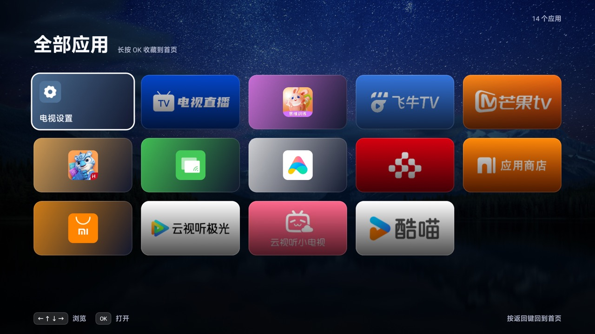
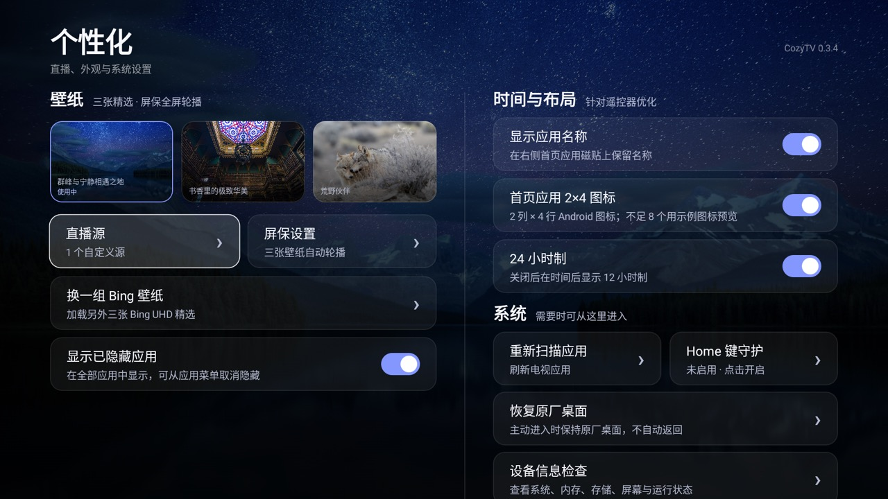

# CozyTV

面向 Android TV / Google TV 的轻量桌面，使用 Kotlin、Jetpack Compose 和 Media3，
针对遥控器与低配置电视优化。


## 主要功能

- 16:9 首页直播预览，进入桌面自动播放，支持多个 M3U / M3U8 源自动切换。
- 信号源菜单包含 TVLive、HDMI、AV 和电视输入；TVLive 在首页播放，其他输入直接全屏打开。
- 信号源可保存为默认项；冷启动 CozyTV 时会自动打开默认的全屏输入。
- 内置完整 TVLive，支持频道列表、数字键切台、收藏和频道抽屉。
- Apple TV 风格首页应用磁贴，支持 1×4 与 2×4 两种布局。
- 首页应用长按 OK 可收藏、隐藏或卸载；全部应用页同样支持这些操作。
- 首页菜单键保留给电视固件，可正常弹出原厂菜单。
- 首页 20 秒无按键操作后自动打开 TVLive 全屏直播。
- Bing 每日三张 UHD 壁纸缩略图，可选择首页壁纸；屏保每 15 秒自动轮播。
- 应用图标采用居中的环形标志，不使用额外三角装饰。
- 控制中心包含网络、系统设置、原厂桌面、音量和亮度。
- 小米电视通过固件 `TvService` 控制实体背光，其他设备回退到应用遮罩。
- Home 键无障碍守护只拦截 Home 键；主动进入原厂桌面时不会被自动拉回。
- 电视开机完成后自动进入 CozyTV，不主动打开原厂桌面。
- 手动检查 GitHub Releases，下载后校验 SHA-256、包名、版本和签名。
- 设备信息检查页只读显示系统、屏幕、内存、存储、网络和运行状态。

## 界面






## 默认桌面

控制中心中的“原厂桌面”会直接打开原厂桌面：

- 普通入口只打开原厂桌面，不修改系统默认设置，也不会自动返回。
- 在原厂桌面按 Home 会返回 CozyTV。
- 个性化页“系统 → 恢复原厂桌面”同样只打开原厂桌面。

首次使用需在“个性化 → 系统 → Home 键守护”开启无障碍服务：

```bash
adb shell settings put secure enabled_accessibility_services \
  app.cozytv/app.cozytv.guard.HomeAccessibilityService
adb shell settings put secure accessibility_enabled 1
```

## CleanYourTV 清理工具箱

[CleanYourTV](https://github.com/Gathin23/cleanyourtv) 是一套独立于 CozyTV App
的电视清理能力，通过电脑端 ADB 辅助使用，不会增加应用内的清理权限或后台行为。

- 可识别电视型号，并匹配对应的机型应用清单。
- 可分类处理广告、遥测数据及可选预装应用。
- 执行前可预览待处理项目，执行后保留恢复记录。
- 默认避开 HOME、HDMI / AV / 电视输入、Wi-Fi 设置向导和核心系统组件。

## 软件更新

“个性化 → 软件更新”手动检查 GitHub Releases。发布附件命名为
`CozyTV-vX.Y.Z-release.apk`，并且必须与已安装版本使用相同签名。

```bash
./gradlew assembleRelease \
  -PcozytvVersionCode=7 \
  -PcozytvVersionName=0.3.4
```

更新地址可通过 `-PcozytvUpdateUrl=<GitHub API 或静态清单>` 覆盖。

## 构建

需要 JDK 17 和 Android SDK 36。

```bash
export JAVA_HOME="$HOME/Library/Java/JavaVirtualMachines/jdk-17.0.21+9/Contents/Home"
./gradlew assembleDebug
adb install -r app/build/outputs/apk/debug/app-debug.apk
adb shell am start -n app.cozytv/.MainActivity
```

Release APK：`app/build/outputs/apk/release/app-release-unsigned.apk`。

## 验证

已在 MiTV-ASTP0（Android 9，1920×1080）和 Android TV API 33 模拟器验证：

- Amlogic HEVC 直播硬解与多源切换
- 控制中心、实体背光 100→95→100
- Home 键守护与原厂桌面入口
- 首页菜单键透传与 20 秒无操作自动进入 TVLive
- TVLive 首页播放及 HDMI / AV / 电视输入全屏切换
- 从个性化、全部应用等内部页面按 Home 均会回到 CozyTV 首页
- 全部应用、设备信息和更新流程
- Debug、Release、单元测试与 Android Lint

TVLive 为 Apache-2.0；Aerial TV 与 CleanYourTV 为 MIT。来源说明见
[`docs/REFERENCE_NOTES.md`](docs/REFERENCE_NOTES.md)。
